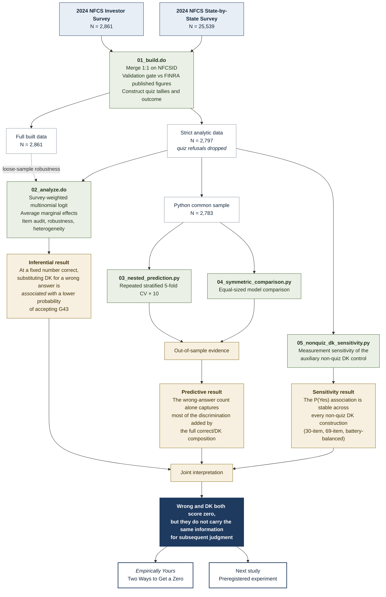

# Study Workflow

How Project 1 runs, from the two public-use source files to the two things that came out the other end.

## The pipeline, as files

Which file does what, and where each artifact lives in the repository.

![ETL pipeline for Household Finance Lab Project 1. Source data from the 2024 FINRA NFCS Investor Survey (N = 2,861) and State-by-State Survey (N = 25,539) feeds code/01_build.do, which merges on NFCSID, runs a validation gate against FINRA published figures, and freezes an analytic sample of 2,797. code/02_analyze.do runs the survey-weighted multinomial logit and marginal effects in Stata. The handoff to Python is output/nfcs_p1_built_analytic.csv, a gitignored respondent-level export of 2,797 rows by 265 columns. Three Python scripts — 03_nested_prediction, 04_symmetric_comparison and 05_nonquiz_dk_sensitivity, with support modules paths.py, wmnl.py and audit_spec.py — produce aggregate result tables in output/tables/, which feed the Empirically Yours write-up. Documentation, metadata and infrastructure files are listed beneath.](etl-pipeline.svg)

**The handoff is the part worth reading twice.** What crosses from Stata to Python is
`output/nfcs_p1_built_analytic.csv` — respondent-level, 2,797 rows, gitignored and never
published. It is not `stata_primary_results.csv`, which is a summary of marginal effects
and an *output* of the study rather than an input to anything.

## The pipeline, as analysis

The same study seen as questions and estimands rather than as files.

**Reading it.** Blue is source data, green is code, white with a grey outline is a frozen dataset, sand is a result, and the dashed line is the one place the analysis reaches back to the full built file — the loose-sample robustness check, which needs the 64 respondents the strict rule drops.

**Sample sizes.** 2,861 respondents in the Investor Survey → 2,797 after dropping anyone with a refusal on the 11 quiz items → 2,796 in models requiring valid G43 → 2,783 in models also requiring valid self-assessed knowledge, which is the common sample the nested predictive comparison uses so that every specification is scored on identical respondents.

**Not shown.** The validation gate inside `01_build.do` halts the run if the reconstruction drifts from FINRA's published figures; the analysis never starts if it fails. See `ANALYTICAL-DECISIONS.md` §7 and §7a.

---

*This diagram renders natively on GitHub. To use it elsewhere — slides, a poster, LinkedIn — paste the code block into [mermaid.live](https://mermaid.live) and export SVG or PNG.*
